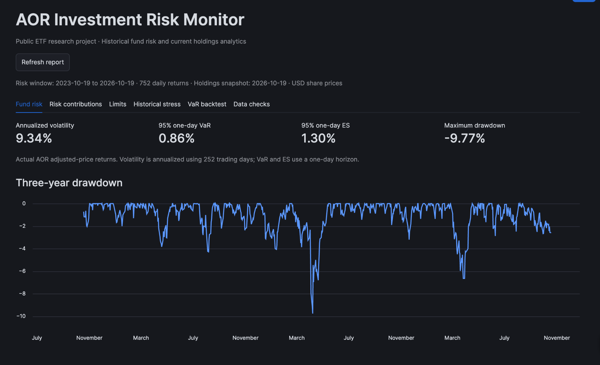

# AOR Investment Risk Monitor

A portfolio risk reporting project built with **Snowflake SQL, Python, Snowpark, pandas, and Streamlit**. It uses public holdings and historical market prices to report fund risk, explain current portfolio risk contributions, monitor illustrative limits, and evaluate historical VaR forecasts.

## Dashboard

Additional views: [Capital allocation](screenshots/02_capital_allocation.png) · [Risk contributions](screenshots/03_risk_contributions.png) · [Limit monitoring](screenshots/04_limit_monitoring.png) · [VaR backtesting](screenshots/05_var_backtesting.png)

## Results

Report window: **2023-10-19 to 2026-10-19**. Holdings snapshot: **2026-10-19**. Prices and market values are expressed in USD.

| Measure | Result |
|---|---:|
| Actual AOR annualized volatility | 9.34% |
| Historical one-day 95% VaR | 0.86% |
| Historical one-day 95% expected shortfall | 1.30% |
| Maximum drawdown within the reporting window | −9.77% |
| Modeled current-holdings annualized volatility | 9.58% |
| Equity / fixed income / cash allocation | 62.09% / 37.81% / 0.09% |
| Demonstration limit breaches / checks passing | 2 / 7 |
| VaR backtest observations | 752 |
| VaR exceptions | 36 |
| Observed exception rate / reference rate | 4.79% / 5.00% |

**Key finding:** IVV accounts for **35.75% of capital but 52.43% of modeled risk**, while IUSB accounts for **32.00% of capital and 7.49% of modeled risk**. Capital allocation alone does not describe the portfolio's risk concentration.

IVV and IUSB exceed the project's illustrative 30% per-ETF allocation limit by **5.75 and 2.00 percentage points**, respectively. These are demonstration rules, not the issuer's or IMCO's investment policies.

## Data

- **Holdings:** Public iShares AOR direct-holdings export, containing seven ETF positions and two cash or money market balances.
- **Prices:** Yahoo Finance adjusted daily prices downloaded using yfinance for AOR, IVV, IUSB, IDEV, IEMG, IAGG, IJH, and IJR.
- **Loaded price history:** 13,832 observations across eight ETFs, from 2019-12-02 through 2026-10-19. The earlier history supports historical stress analysis and the rolling VaR estimation window.
- **Published holdings weights:** Retained as reported, totaling 99.99% because of rounding. Negative cash is retained.

## Analytics and methodology

| Component | Method |
|---|---|
| Daily returns | Adjusted close divided by the preceding adjusted close, minus one |
| Annualized volatility | Sample standard deviation of daily returns multiplied by the square root of 252 |
| Historical 95% VaR | Negative fifth percentile of daily returns |
| Expected shortfall | Negative average of returns at or below the fifth percentile |
| Drawdown | Decline from the running peak within the report window, including the preceding available close as a baseline |
| Current-holdings risk contributions | Position weight multiplied by its covariance with modeled portfolio returns, divided by modeled portfolio return variance |
| Historical stress | Actual cumulative AOR returns over selected past stress periods |
| VaR backtesting | Each day's realized loss compared with a forecast estimated from the preceding 252 returns |

Fund risk uses **actual historical AOR returns**. Risk contributions use a separate **constant-weight portfolio model based on the current holdings snapshot**. Consequently, their annualized volatility estimates differ.

The backtest excludes the day being tested from its estimation sample. Its exception rate measures overall coverage; it does not establish that exceptions are independent or that the model is fully validated.

## Workflow

Public data is prepared as CSV files and loaded manually into `AOR_RISK.RAW`. SQL views in `AOR_RISK.ANALYTICS` calculate returns, risk measures, exposures, limit checks, stress returns, and backtesting results. The Streamlit app queries those views through Snowflake's built-in connection and displays the report.

The report checks inputs and reconciliations before displaying results, including duplicate price keys, invalid prices, missing ETF observations, holdings and exposure totals, risk-share reconciliation, and backtest coverage.

## Project files

Use this layout when assembling the repository:

| Location | Contents |
|---|---|
| `README.md` | Project overview, results, methodology, and setup |
| `streamlit_app.py` | Dashboard application |
| `pyproject.toml` | Python package dependencies |
| `snowflake.yml` | Snowflake deployment configuration |
| `.streamlit/config.toml` | Streamlit configuration |
| `sql/` | The ten numbered SQL scripts below |
| `screenshots/` | The five dashboard screenshots linked above |

| SQL script | Purpose |
|---|---|
| `01_setup.sql` | Database, schemas, warehouse, and raw tables |
| `02_daily_return.sql` | Daily adjusted-price returns |
| `03_data_quality_checks.sql` | Input validation |
| `04_risk_metrics.sql` | Fund volatility, VaR, and expected shortfall |
| `05_drawdown.sql` | Reporting-window drawdowns |
| `06_exposure.sql` | Current holdings and asset-class exposures |
| `07_limit_monitoring.sql` | Illustrative allocation and VaR limits |
| `08_stress_testing.sql` | Historical stress-period returns |
| `09_VaR_backtesting.sql` | Rolling historical VaR and exception evaluation |
| `10_risk_contributions.sql` | Current-holdings portfolio risk decomposition |

## Run in Snowflake

1. Run the setup statements in `sql/01_setup.sql` in a Snowflake account where your role can create the project resources.
2. Load the prepared holdings and adjusted-price CSVs into `AOR_RISK.RAW.HOLDINGS` and `AOR_RISK.RAW.PRICES`, matching the table definitions.
3. Run scripts `02` through `10` in numerical order. Review the data-quality results before using the analytics.
4. Create a Streamlit app in Snowflake Workspaces and replace its starter Python code with `streamlit_app.py`.
5. Make `streamlit`, `pandas`, and `snowflake-snowpark-python` available in the app's runtime. Choose a query warehouse your app's execution role can use, and grant that role access to the project tables and views.
6. Run the app and review its data checks. Deployment settings should reference the resources in your own account.
7. Deploy the app to share it with authorized Snowflake users. The screenshots provide a preview for readers without Snowflake access.

The dashboard uses `st.connection("snowflake").session()` for the Workspaces container runtime. Report values above describe the saved data snapshot; changing the input history or holdings changes the results.

## Model assumptions and scope

- Current holdings remain fixed throughout the risk-contribution estimation sample; this model is not a reconstruction of AOR's historical holdings.
- Cash and money market positions use zero modeled returns. This approximation omits their actual yield and fluctuations.
- ETF-level adjusted returns capture the behavior of the securities. The project does not separately model underlying bond credit risk, derivative exposures, FX sensitivities, or liquidity.
- Data ingestion is manual. Re-running the app refreshes queries against loaded data; it does not download new prices.
- Results demonstrate investment risk analytics and reporting using public data.

